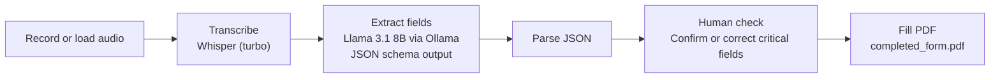

# Speech-to-Text Pathology Request Form (LLM Prototype)

**Dictate a pathology request out loud and get a completed PDF request form back.**

This is my personal prototype of a voice-driven pathology request system. It records a clinician's dictation, transcribes it with OpenAI Whisper, uses a locally run large language model to pull out the patient and clinician details, asks the user to confirm the critical fields, and fills in a PDF request form automatically.

> This is an early, LLM-based version I built while my team and I were developing our final-year capstone at the University of the Witwatersrand. The team's final system replaced the LLM with rule-based field extraction for more predictable results.

---

## How it works



1. **Capture:** record from the microphone (`audio.py`, press Enter to stop) or load an existing audio file.
2. **Transcribe:** Whisper's `turbo` model converts speech to text. Its prompt is primed with common South African names and an email format, to improve accuracy on names and email addresses.
3. **Extract:** Llama 3.1 8B, running locally through Ollama, reads the transcript and returns the fields below as structured JSON. A JSON schema constrains the output, and the model is told not to invent information and to return `null` for anything not mentioned.
4. **Validate:** the user is asked to confirm or correct critical fields such as the patient name, ID number and contact details before anything is written.
5. **Fill the form:** the confirmed values are mapped to the fields of a fillable PDF request form and saved as `completed_form.pdf`.

## Fields extracted

| Patient | Requesting healthcare worker |
|---|---|
| Patient name | Name |
| Date of birth | HPCSA number |
| Patient ID number | Contact number |
| Address | Email address |
| Sex | Hospital name |
| Symptoms | Ward number |
| Diagnosis | |
| Tests requested (list) | |

## Why run everything locally?

Both Whisper and the LLM run on the user's own machine. **No patient audio or data is sent to an external service.** That matters when you're handling medical information.

## Tech stack

| Area | Technology |
|---|---|
| Language | Python |
| Speech-to-text | OpenAI Whisper (`turbo`) |
| Field extraction | Llama 3.1 8B via Ollama, with a JSON-schema structured output |
| Audio capture | sounddevice, NumPy, SciPy |
| PDF filling | pypdf |

## Project structure

| File | Purpose |
|---|---|
| `main.py` | Runs the full pipeline |
| `audio.py` | Records audio from the microphone to `recording.wav` |
| `transcription.py` | Transcribes audio with Whisper |
| `llm.py` | Extracts structured fields with Llama 3.1 via Ollama |
| `toJson.py` | Parses the model's response into JSON |
| `validator.py` | Asks the user to confirm or correct critical fields |
| `pdf_filler.py` | Fills `Request_Form.pdf` and saves `completed_form.pdf` |

## Getting started

**Requirements:** Python 3.10+, [FFmpeg](https://ffmpeg.org/) (needed by Whisper) and [Ollama](https://ollama.com/).

```bash
# 1. Install the Python packages
pip install -r requirements.txt

# 2. Download the language model
ollama pull llama3.1:8b

# 3. Run the pipeline
python main.py
```

By default, `main.py` processes the sample recording `clinician_recording3.mp3`. To dictate your own request, uncomment the `record_audio()` line in `main.py` and pass its output to `transcribe()`.

A GPU speeds up transcription considerably, but Whisper and Ollama also run on a CPU, just more slowly.

## Limitations and lessons learned

- **LLM output isn't always consistent.** The same dictation could produce slightly different results between runs. This is the main reason the team's final system switched to rule-based extraction, which behaves predictably.
- **Not every field reaches the PDF yet.** The sex and requested-tests fields are extracted, but the form uses checkboxes for them, and those aren't filled automatically yet.
- **The confirmation step runs in the terminal.** A graphical interface would suit clinical users better.

## Author

**Lefa Mofokeng** · [GitHub](https://github.com/Lefamofokeng) · [LinkedIn](https://www.linkedin.com/in/lefa-mofokeng-941544164)
WTC-CF4F7EP4
